# Teilaufgabe 1: Ideensteckbrief – Variante B (Marktplatz)

**Modul:** Mobile Development – Transferarbeit I
**Technologie:** React Native, Expo, TypeScript
**Autor:** Rodrigo Zihlmann
**Datum:** 18. November 2026

---

## Arbeitstitel

**ReWear Shop** – Second-Hand-Shop für Kleider und Schuhe

## Zielgruppe

- **Verkäufer (eine Person):** Verkauft eigene gebrauchte Kleider und Schuhe, möchte keine Plattformgebühren bezahlen und nicht von fremden Plattformen abhängig sein.
- **Käuferinnen und Käufer:** Freunde, Bekannte, Arbeitskolleginnen und -kollegen oder Personen aus der Region, die günstig gut erhaltene Kleider suchen.
- **Nutzungssituation:**
  - Verkäufer: Erfasst Artikel zu Hause beim Ausmisten direkt mit dem Smartphone.
  - Käufer: Stöbern unterwegs (z. B. im Zug) im aktuellen Angebot und reservieren Artikel, die sie interessieren.

## Problem

- Grosse Verkaufsplattformen verlangen Gebühren und sind oft mit Werbung überladen. Persönliche Verkäufe über WhatsApp-Gruppen sind unübersichtlich: Fotos gehen im Chat unter, und niemand weiss, was noch verfügbar ist.
- Private Produktfotos wirken oft unprofessionell (unordentlicher Hintergrund, schlechtes Licht).
- Der Verkäufer verliert bei mehreren Interessenten schnell den Überblick, wer welchen Artikel reserviert hat.

## Nutzen

- **Für Käufer:**
  - Auf einen Blick sehen, was neu hochgeladen wurde (Home).
  - Gezielt suchen über klare Kategorien und Filter für Zustand, Grösse, Farbe und Verwendung (Winter, Sommer, Sport).
  - Interessante Artikel als Favoriten speichern und später vergleichen.
  - Einfach reservieren, ohne sich registrieren zu müssen.
- **Für den Verkäufer:**
  - Artikel schnell und direkt mit dem Smartphone inserieren (Foto aufnehmen, Angaben erfassen, fertig).
  - In einem nächsten Schritt: **automatische Hintergrundentfernung** für professionelle Produktfotos (geplantes Alleinstellungsmerkmal, siehe Ausblick).
  - Reservationen gesammelt an einem Ort sehen, bestätigen oder ablehnen.
  - Artikel als verkauft markieren, sodass sie sofort aus dem Shop verschwinden.
  - Überblick über die Einnahmen: verkaufte Artikel und Gesamtsumme pro Zeitraum.

## Kernfunktionen (priorisiert)

| Prio | Kernfunktion | Rolle | Kurzbeschreibung |
|------|--------------|-------|------------------|
| 1 | **Artikel inserieren und verwalten** | Verkäufer | Artikel mit Foto, Titel, Kategorie, Grösse, Farbe, Zustand und Preis erfassen, bearbeiten und löschen. Nur der eingeloggte Verkäufer darf Artikel verändern. |
| 2 | **Angebot entdecken, suchen und favorisieren** | Käufer | Neueste Artikel im Home-Tab anzeigen, über Kategorien (Abteilung → Kategorie → Unterkategorie) suchen, nach Zustand, Grösse, Farbe und Verwendung filtern, Detailansicht öffnen und Artikel lokal als Favoriten speichern. |
| 3 | **Artikel reservieren und Reservation bearbeiten** | Käufer + Verkäufer | Käufer sendet eine Reservation mit Name, Kontakt und Nachricht. Der Artikel wird als «Reserviert» angezeigt. Der Verkäufer bestätigt, lehnt ab oder markiert den Artikel als verkauft. Verkaufte Artikel erscheinen in der Verkaufsübersicht. |

**Kernablauf:**
Verkäufer fügt Artikel hinzu → Käufer findet Artikel über Home oder Suche → Käufer öffnet die Detailansicht und reserviert → Verkäufer bestätigt → Übergabe und Bezahlung ausserhalb der App (z. B. TWINT, bar) → Verkäufer markiert den Artikel als «Verkauft».

## Rollen und Berechtigungen

| Aktion | Käufer (ohne Login) | Verkäufer (mit Login) |
|--------|:-------------------:|:---------------------:|
| Tabs Home, Suche, Favoriten nutzen | ja | ja |
| Favoriten speichern (lokal) | ja | ja |
| Artikel reservieren | ja | – |
| Tab «Hinzufügen» sehen | nein | ja |
| Artikel erfassen / bearbeiten / löschen | nein | ja |
| Reservationen einsehen und bearbeiten | nein | ja |
| Verkaufsübersicht und Einnahmen einsehen | nein | ja |

Die Berechtigungen werden **serverseitig** durchgesetzt (z. B. über Zugriffsregeln des gewählten Backend-Dienstes), nicht nur durch das Ausblenden von Buttons in der App.

## Navigation und Ansichten

### Tab-Struktur

| Tab | Sichtbar für | Inhalt |
|-----|--------------|--------|
| **Home** | alle | Zuletzt hochgeladene, verfügbare Artikel (neueste zuerst) als Produktkacheln |
| **Suche** | alle | Kategorien, Freitextsuche, Ergebnisliste mit Filtern und Sortierung |
| **Favoriten** | alle | Alle favorisierten Artikel |
| **Hinzufügen** | **nur eingeloggter Verkäufer** | Formular zum Erfassen eines neuen Artikels inkl. Foto (Kamera oder Galerie) |

- Ein Tipp auf eine **Produktkachel** (in Home, Suche oder Favoriten) öffnet die **Detailansicht** (Stack-Navigation innerhalb des jeweiligen Tabs).
- **Login für den Verkäufer** über das Profil-Symbol oben rechts im Home-Tab. Nach dem Login erscheint der Tab «Hinzufügen», und über dasselbe Symbol erreicht der Verkäufer seinen Verkäufer-Bereich (eigene Artikel, Reservationen, Verkaufsübersicht).
- Das Ausblenden des Tabs dient nur der Bedienung. Der eigentliche Schutz erfolgt serverseitig (siehe Rollen und Berechtigungen).

### Kategorisierung (angelehnt an Zalando)

Dreistufige Gliederung: **Abteilung → Kategorie → Unterkategorie**

| Abteilung | Kategorie | Unterkategorien (Beispiele) |
|-----------|-----------|-----------------------------|
| Damen, Herren, Kinder | Bekleidung | Jacken & Mäntel, Pullover & Strick, T-Shirts & Tops, Hosen & Jeans, Kleider & Röcke |
| | Schuhe | Sneaker, Stiefel, Halbschuhe, Sandalen, Sportschuhe |
| | Accessoires | Taschen, Mützen & Schals, Gürtel |

Die Kategorien sind in der ersten Version fest im Code hinterlegt.

### Darstellung der Suche (angelehnt an Digitec)

- **Kategorie-Kacheln** mit Bezeichnung und Anzahl verfügbarer Artikel, z. B. «Schuhe (12)»
- **Brotkrumen-Navigation** (Breadcrumb), z. B. «Herren › Schuhe › Sneaker», zum schnellen Zurückspringen
- **Ergebnisliste** mit Bild links und den wichtigsten Angaben rechts (Titel, Grösse, Zustand, Preis, Favoriten-Herz)
- **Trefferanzahl**, **Sortierung** (Neueste, Preis aufsteigend, Preis absteigend)
- **Filter-Button** mit Anzahl aktiver Filter; aktive Filter erscheinen als entfernbare **Filter-Chips** über der Liste

### Filter

| Filter | Werte | Auswahl |
|--------|-------|---------|
| **Zustand** | Neu, Wie neu, Gut, Gebrauchsspuren, Kleine Defekte | Mehrfachauswahl |
| **Grösse** | Kleider: XS–XXL · Schuhe: EU 35–48 · Kinder: 92–164 (angezeigt werden nur Grössen, die in der gewählten Kategorie vorkommen) | Mehrfachauswahl |
| **Verwendung** | Winter, Sommer, Sport, Ganzjährig | Mehrfachauswahl |
| **Farbe** | Schwarz, Weiss, Grau, Beige, Braun, Blau, Grün, Rot, Rosa, Gelb, Orange, Violett, Mehrfarbig | Mehrfachauswahl |

Farben werden immer als **Farbpunkt mit Namen** angezeigt (z. B. «● Blau»), damit die Information nicht nur über die Farbe vermittelt wird.

### Ansichten (Screens)

**Für alle:**
1. **Home:** Raster mit Produktkacheln der neuesten verfügbaren Artikel, Pull-to-Refresh. Leerzustand: «Noch keine Artikel – schau bald wieder vorbei».
2. **Suche – Kategorien:** Abteilungs-Auswahl (Damen/Herren/Kinder), Kategorie-Kacheln, Suchfeld (Titel, Marke).
3. **Suche – Ergebnisliste:** Liste mit Sortierung, Filter-Button und Filter-Chips. Leerzustand: «Keine Treffer – Filter zurücksetzen».
4. **Filter (Bottom Sheet):** Zustand, Grösse, Verwendung, Farbe; Button «X Artikel anzeigen» und «Zurücksetzen».
5. **Detailansicht:** Grosses Foto, Preis, Status (als Text und Farbe), Abteilung/Kategorie, Grösse, Farbe, Zustand, Verwendung, Beschreibung, Favoriten-Herz und Button «Reservieren».
6. **Reservationsformular:** Name, E-Mail oder Telefonnummer, Nachricht; mit Eingabevalidierung.
7. **Favoriten:** Liste der favorisierten Artikel. Verkaufte Artikel werden mit «Nicht mehr verfügbar» gekennzeichnet. Leerzustand: «Noch keine Favoriten – tippe bei einem Artikel auf das Herz».

**Nur Verkäufer (mit Login):**
8. **Login:** E-Mail und Passwort.
9. **Hinzufügen (eigener Tab):** Formular mit Foto (aufnehmen mit der Kamera oder aus der Galerie wählen, mit Vorschau), Titel, Abteilung, Kategorie, Unterkategorie, Grösse, Farbe (Auswahl aus fester Liste), Zustand, Verwendung, Preis und Beschreibung; mit Eingabevalidierung. Dasselbe Formular wird zum Bearbeiten verwendet.
10. **Verkäufer-Bereich:** Eigene Artikel mit Status sowie offene Reservationen (mit Anzahl). In der Detailansicht sieht der Verkäufer zusätzlich «Bearbeiten», «Status ändern» und «Löschen».
11. **Verkaufsübersicht:** Liste der verkauften Artikel mit Verkaufsdatum und Verkaufspreis sowie die **Gesamtsumme der Einnahmen**. Die Ansicht ist nach Zeitraum filterbar: letzte 3 Monate, letztes Jahr oder frei wählbarer Datumsbereich (von – bis). Leerzustand: «Im gewählten Zeitraum wurde nichts verkauft».

**Wiederverwendbare Komponenten (geplant):**

| Komponente | Verwendet in |
|------------|--------------|
| `ProductTile` (Produktkachel) | Home, Favoriten |
| `ProductListItem` (Listeneintrag) | Suche, Verkäufer-Bereich, Verkaufsübersicht |
| `FavoriteButton` (Herz) | Kachel, Listeneintrag, Detailansicht |
| `CategoryTile` | Suche |
| `FilterChip` / `FilterSheet` | Suche, Verkaufsübersicht (Zeitraum) |
| `ColorChip` (Farbpunkt mit Name) | Filter, Hinzufügen, Detailansicht |
| `StatusBadge` | Kachel, Listeneintrag, Detailansicht |
| `FormField`, `PrimaryButton` | Hinzufügen, Reservation, Login |
| `EmptyState`, `ErrorMessage` | Home, Suche, Favoriten, Verkäufer-Bereich |

## Daten

Das Datenmodell ist ein erster Entwurf und wird in Teilaufgabe 2 zusammen mit der Wahl des Backends verfeinert.

### Backend (gemeinsame Daten im Backend)

**Tabelle `articles`**

| Feld | Typ | Pflicht | Beispiel |
|------|-----|---------|----------|
| `id` | uuid | ja | automatisch |
| `title` | text | ja | «Nike Air Max 90» |
| `department` | enum | ja | Damen, Herren, Kinder |
| `category` | enum | ja | Bekleidung, Schuhe, Accessoires |
| `subcategory` | text | ja | «Sneaker», «Jacken & Mäntel» |
| `size` | text | ja | «42» / «M» / «128» |
| `color` | enum | ja | Hauptfarbe, z. B. «Blau» (bei mehreren Farben «Mehrfarbig») |
| `usage` | text[] | ja (mind. 1) | Winter, Sommer, Sport, Ganzjährig |
| `brand` | text | nein | «Nike» |
| `condition` | enum | ja | Neu, Wie neu, Gut, Gebrauchsspuren, Kleine Defekte |
| `price` | numeric | ja | 45.00 (CHF, > 0) |
| `description` | text | nein | «Kaum getragen» |
| `image_url` | text | nein | URL im Datei-Speicher (Storage) |
| `status` | enum | ja | Verfügbar, Reserviert, Verkauft |
| `sold_price` | numeric | nein | 40.00 (tatsächlich erzielter Preis, für die Gesamtsumme) |
| `sold_at` | timestamp | nein | Verkaufsdatum (für den Zeitraumfilter) |
| `created_at` / `updated_at` | timestamp | ja | automatisch |

**Tabelle `reservations`**

| Feld | Typ | Pflicht | Beispiel |
|------|-----|---------|----------|
| `id` | uuid | ja | automatisch |
| `article_id` | uuid (Fremdschlüssel) | ja | Verweis auf den Artikel |
| `buyer_name` | text | ja | «Anna M.» |
| `buyer_contact` | text | ja | E-Mail oder Telefonnummer |
| `message` | text | nein | «Kann ich sie am Samstag abholen?» |
| `status` | enum | ja | Offen, Bestätigt, Abgelehnt |
| `created_at` | timestamp | ja | automatisch |

### Lokal (auf dem Gerät)

- **Favoriten:** Liste von Artikel-IDs (AsyncStorage). Sie bleibt nach einem Neustart erhalten.
- **Eigene Reservationen:** Damit der Käufer seine gesendeten Reservationen wiederfindet.
- **Cache des zuletzt geladenen Angebots:** Ohne Internet wird das letzte bekannte Angebot mit dem Hinweis «Offline – Stand vom …» angezeigt.

## API und Backend (Ideen – noch nicht festgelegt)

Die Wahl von Backend und API ist noch offen und wird in Teilaufgabe 2 (Anforderungen & Konzept) anhand von Lösungsvarianten entschieden. Folgende Ideen kommen in Frage:

### Backend: mögliche Varianten

Da mehrere Personen dieselben Artikel sehen sollen, braucht es einen gemeinsamen Datenspeicher. Ein eigener Server ist nicht vorgesehen; in Frage kommt ein Backend-as-a-Service:

| Idee | Was es bieten würde | Noch zu klären |
|------|---------------------|----------------|
| **Supabase** | Datenbank, Login, Bildspeicher, Zugriffsregeln | Gratis-Limits, Pausierung inaktiver Projekte |
| **Firebase** | Datenbank (Firestore), Login, Bildspeicher | Ist der Bildspeicher im Gratis-Tarif verfügbar? |
| **Appwrite (Cloud)** | Datenbank, Login, Bildspeicher | Reife der React-Native-Unterstützung, Limits |

Kriterien für die Auswahl: Kosten (Gratis-Tarif), Einarbeitungsaufwand, Unterstützung für Expo/React Native, Möglichkeit, Berechtigungen serverseitig abzusichern.

### Externe APIs: mögliche Ideen

| Idee | Nutzen für die App | Zeitpunkt |
|------|---------------------|-----------|
| **Hintergrundentfernung** (z. B. remove.bg, Photoroom) | Professionelle Produktfotos | Nächster Schritt (siehe Ausblick) |

### Grundsätze unabhängig von der Wahl

- Zugangsdaten und Schlüssel liegen in einer `.env`-Datei, die **nicht** ins Repository gelangt; eine `.env.example` ohne echte Werte dokumentiert die nötige Konfiguration.
- Administrative Schlüssel mit Vollzugriff werden nie in der App verwendet.
- Fehler beim Laden oder Speichern (z. B. keine Verbindung) werden abgefangen und verständlich angezeigt.

## Gerätefunktion

- **Kamera und Fotogalerie** (`expo-image-picker`) zum Fotografieren der Artikel im Verkäuferbereich.
- **Fachlicher Nutzen:** Artikel werden direkt dort fotografiert und inseriert, wo sie aussortiert werden.
- **Berechtigungen:** Werden erst bei Bedarf angefragt. Bei Ablehnung erscheint ein Hinweis mit Link zu den Einstellungen; der Artikel kann ohne Foto als Entwurf gespeichert werden.
- _(optional)_ **Teilen-Funktion** (`expo-sharing`): Käufer können einen Artikel mit Freunden teilen.

## Abgrenzung (nicht Teil der ersten Version)

- **Nur ein Verkäufer:** Keine Registrierung weiterer Verkäufer, kein Multi-Vendor-Marktplatz
- **Kein Käufer-Login:** Reservation nur mit Name und Kontaktangabe
- **Keine Bezahlung in der App:** Bezahlung und Übergabe erfolgen persönlich (bar, TWINT)
- Kein Versand, keine Versandetiketten
- Kein Chat bzw. keine Echtzeitkommunikation zwischen Käufer und Verkäufer
- Keine Push-Benachrichtigungen (optional als spätere Erweiterung)
- Keine Bewertungen und Rezensionen
- Keine Suchaufträge oder Benachrichtigungen bei neuen Artikeln
- Kategorien und Filterwerte sind fest vorgegeben (keine Verwaltung in der App)
- Favoriten werden nur lokal auf dem Gerät gespeichert (keine Synchronisation zwischen Geräten)
- **Keine Hintergrundentfernung** bei Fotos (nächster Schritt, siehe Ausblick)
- Nur ein Hauptfoto pro Artikel
- Keine Veröffentlichung im App Store / Play Store

## Ausblick: Nächster Schritt nach der ersten Version

**Automatische Hintergrundentfernung für Produktfotos** (geplantes Alleinstellungsmerkmal)

- Beim Hinzufügen eines Artikels kann der Verkäufer den Hintergrund des Fotos automatisch entfernen lassen; der Artikel erscheint auf einem neutralen, hellen Hintergrund.
- Vorher/Nachher-Vergleich in einem eigenen Foto-Editor; das Originalfoto bleibt erhalten.
- Mögliche Umsetzung: externe API (z. B. remove.bg, Photoroom) oder Verarbeitung auf dem Gerät (ML Kit / Apple Vision, benötigt einen Expo Development Build).
- Vorbereitung in der ersten Version: Der Foto-Upload ist als eigener, gekapselter Schritt umgesetzt, damit die Hintergrundentfernung später ohne grossen Umbau ergänzt werden kann.

## Risiken und offene Fragen

| Risiko / Frage | Mögliche Massnahme |
|----------------|--------------------|
| **Deutlich grösserer Umfang** als eine reine Offline-App (Backend, Auth, Rollen) bei nur 30 Stunden | Backend-as-a-Service statt eigenem Server; Käuferbereich ohne Login |
| Fehlerhafte Berechtigungen: Käufer könnten Artikel verändern | Zugriffsregeln serverseitig einrichten und mit Testfällen prüfen |
| Zwei Käufer reservieren gleichzeitig denselben Artikel | Status serverseitig prüfen (nur reservieren, wenn «Verfügbar»), verständliche Rückmeldung an den zweiten Käufer |
| Käufer brauchen die App: keine Store-Veröffentlichung, nur Expo Go bzw. Link/QR-Code | Einschränkung dokumentieren; Testkäufer erhalten den QR-Code |
| Speicherung von Kontaktdaten der Käufer (Datenschutz, revDSG) | Nur minimal nötige Daten erfassen, Hinweis im Formular, Reservationen nach Abschluss löschen |
| Missbrauch oder Spam-Reservationen ohne Login | Pflichtfelder und Validierung; Verkäufer kann Reservationen ablehnen und löschen |
| Backend-Wahl noch offen; Gratis-Limits des gewählten Dienstes (Datenbank, Bildspeicher) | Varianten in Teilaufgabe 2 vergleichen, Limits früh prüfen, Bilder vor dem Upload verkleinern (`expo-image-manipulator`) |
| Keine Internetverbindung | Lokaler Cache, Offline-Hinweis, Fehlermeldungen beim Speichern |
| Kategorien, Filter und Sortierung erhöhen den Umfang | Kategorien fest im Code, Filterung als Datenbankabfrage; Unterkategorien und Freitextsuche als «Kann»-Ziel priorisieren |
| Verkaufsübersicht: Gesamtsumme und Zeitraumfilter müssen korrekt rechnen | Verkaufspreis und -datum beim Markieren als «Verkauft» erfassen; Randfälle (leerer Zeitraum, Datum «von» nach «bis») testen |
| Favorisierter Artikel wird verkauft oder gelöscht | Favoriten zeigen «Nicht mehr verfügbar» an bzw. entfernen gelöschte Artikel automatisch |
|

---

## Wireframes

Die Nummern entsprechen den Ansichten im Kapitel «Ansichten (Screens)». Bilder und Artikel sind Platzhalter.

**Für alle (Käufer):**

| 1 Home | 2 Suche – Kategorien | 3 Suche – Ergebnisliste | 4 Filter |
|:------:|:--------------------:|:-----------------------:|:--------:|
| 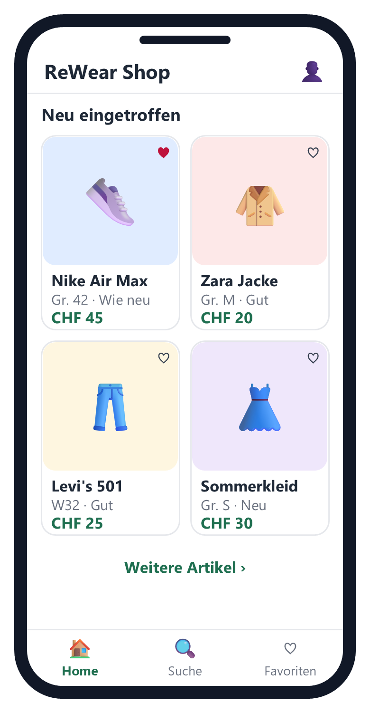 | 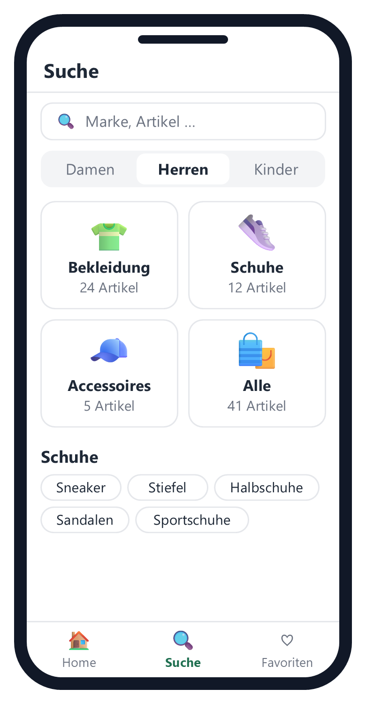 | 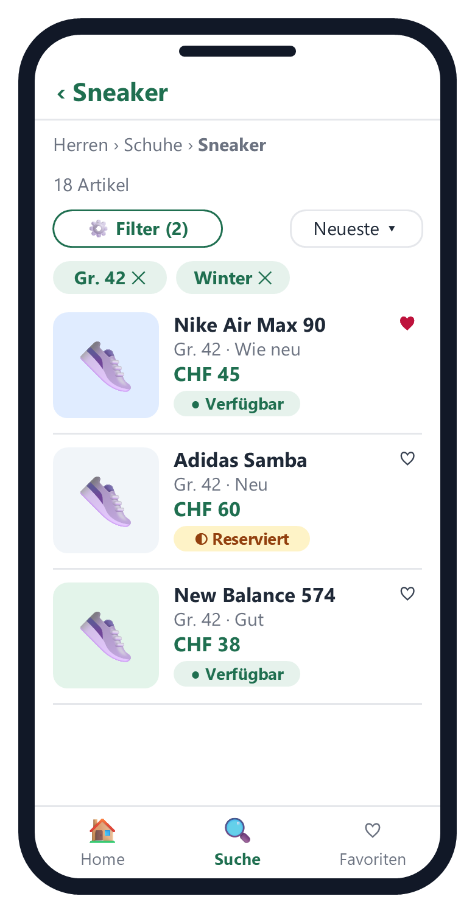 | 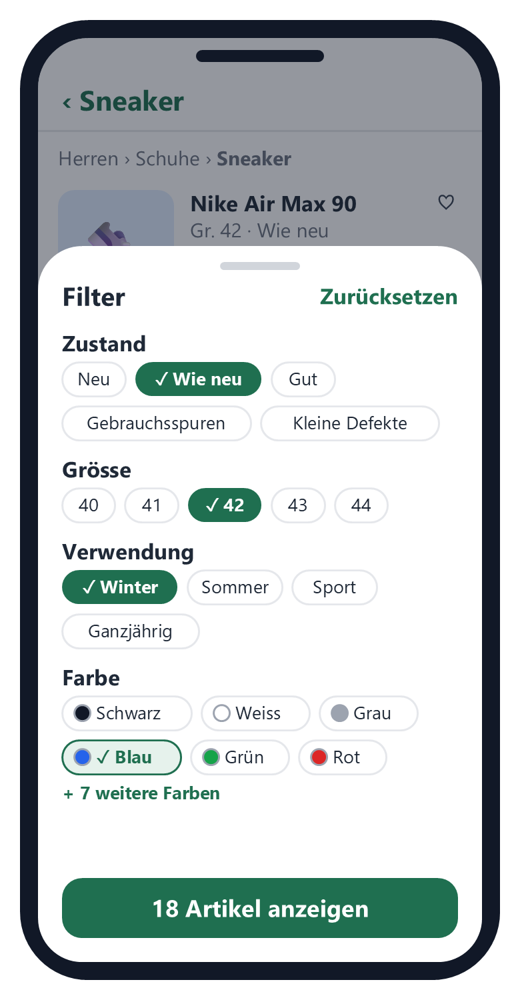 |

| 5 Detailansicht | 6 Reservation | 7 Favoriten |
|:---------------:|:-------------:|:-----------:|
| 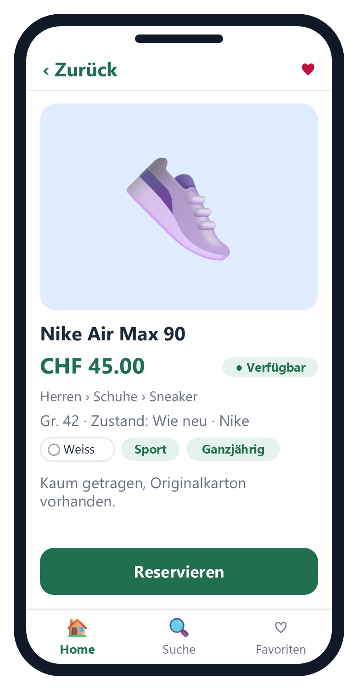 | 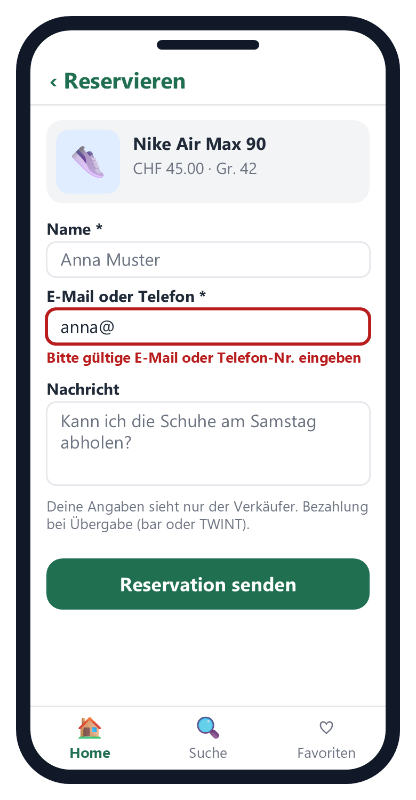 | 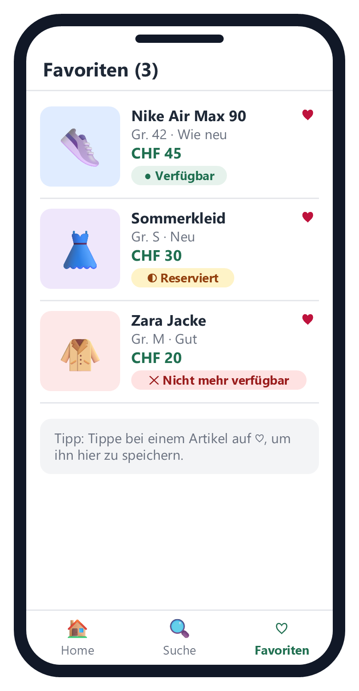 |

**Nur Verkäufer (mit Login):**

| 8 Login | 9 Hinzufügen | 10 Verkäufer-Bereich | 11 Verkaufsübersicht |
|:-------:|:------------:|:--------------------:|:--------------------:|
| 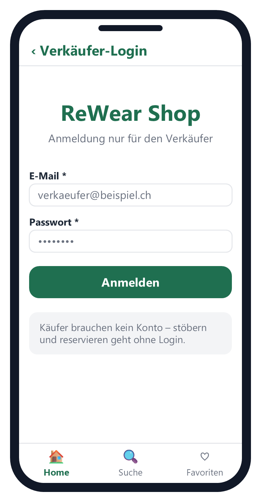 | 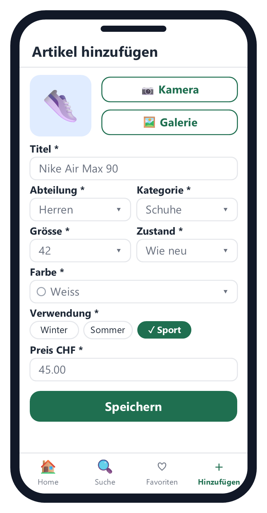 | 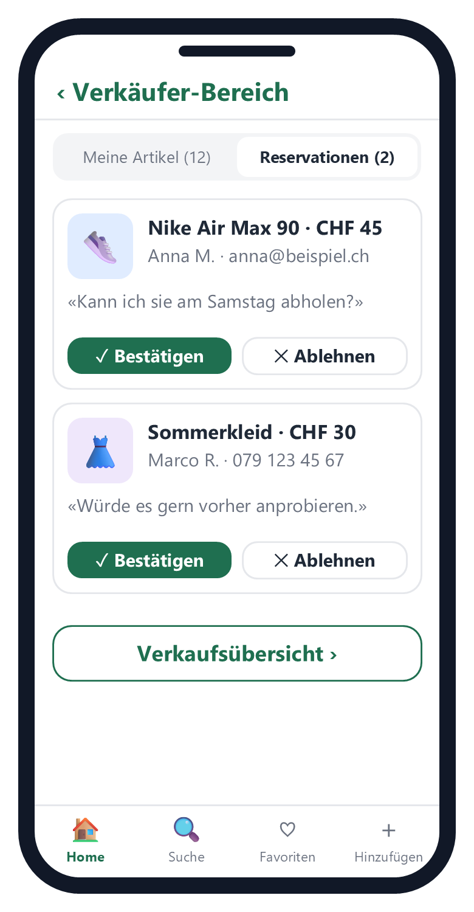 | 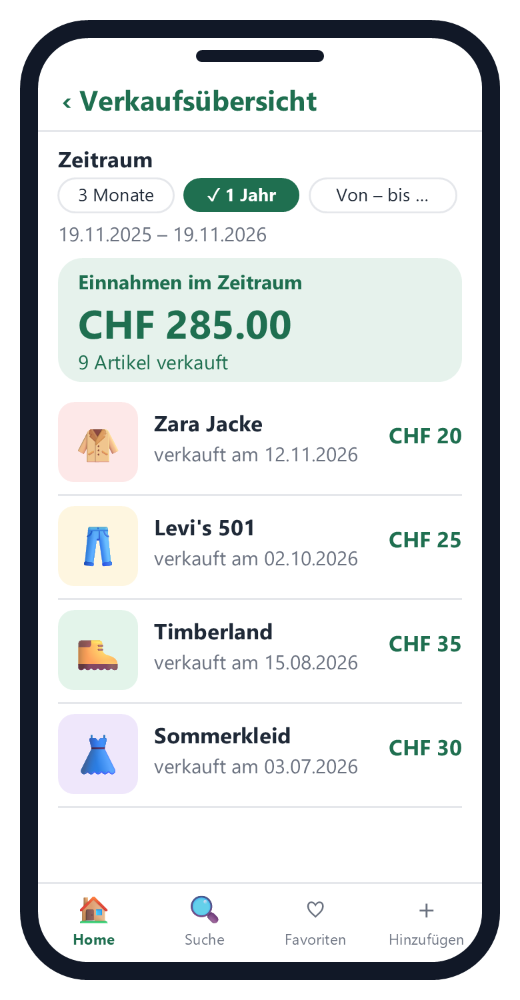 |

Hinweise: Ausgewählte Filter sind mit «✓» markiert, Status und Farben immer zusätzlich mit Text – die Information hängt nie nur an der Farbe. Der Tab «Hinzufügen» erscheint nur nach dem Verkäufer-Login.

**Bedienablauf Käufer:** Home oder Suche → Kategorie wählen → Filter setzen → Produktkachel antippen → Detailansicht → Favorisieren oder Reservieren

**Bedienablauf Verkäufer:** Profil-Symbol → Login → Tab «Hinzufügen» → Foto aufnehmen oder auswählen → Angaben erfassen → Speichern → Artikel erscheint im Home-Tab

---

## Notizen für die 2-minütige Vorstellung

1. **Einstieg (20 s):** «Ich habe viele Kleider, die ich nicht mehr trage. Auf Vinted und Co. zahle ich Gebühren, in WhatsApp-Gruppen geht alles unter.»
2. **Problem & Zielgruppe (25 s):** Ich als einziger Verkäufer; Freunde und Bekannte als Käufer.
3. **Lösung (40 s):** ReWear Shop – Käufer sehen im Home-Tab die neuesten Artikel, suchen nach Kategorien und filtern nach Zustand, Grösse, Farbe und Verwendung (Winter, Sommer, Sport), speichern Favoriten und reservieren ohne Registrierung. Ich füge Artikel über meinen eigenen Tab «Hinzufügen» direkt mit der Kamera hinzu.
4. **Technik (20 s):** React Native mit Expo, ein Backend-as-a-Service für gemeinsame Daten und Login (Ideen: Supabase oder Firebase – Entscheid folgt), Kamera als Gerätefunktion, als API-Idee eine Wetter-API für passende Artikelvorschläge. Nächster Schritt: automatische Hintergrundentfernung für professionelle Produktfotos.
5. **Abgrenzung & Risiken (15 s):** Keine Bezahlung in der App, nur ein Verkäufer. Grösstes Risiko: Umfang und Backend – deshalb mit dem Dozenten abgesprochen.
